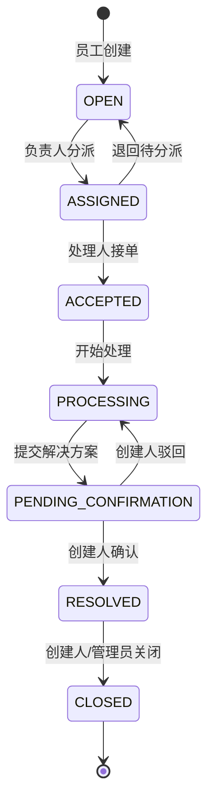

# FlowOps MVP 架构与业务设计

## 1. 项目定位与边界

FlowOps 是一个面向企业内部 IT 服务与协作支持的多租户工单平台。第一版采用**模块化单体**：一个 Spring Boot 应用、一个 MySQL 数据库、一个 Redis 和一个 RabbitMQ 实例；模块在代码中隔离，但不拆分为微服务。

第一版要证明的能力是：在多租户、权限、并发、异步消息与可追溯的约束下，可靠地处理一张工单。AI 知识推荐是后续增强功能，不参与工单能否流转的主流程。

### 纳入 MVP

- 企业/部门/用户/角色/权限及租户数据隔离
- 登录认证、RBAC 鉴权
- 工单创建、查询、分派、接单、处理、确认、关闭
- 工单评论、操作审计与状态流转历史
- 优先级 SLA（响应与解决期限）及超时提醒
- 抢单/分派的乐观锁并发控制
- 基于 Outbox 的可靠事件投递与幂等消费

### 明确不纳入 MVP

- 可视化通用工作流编排器
- 多级审批、附件、邮件、企业 IM 集成
- 多服务拆分、分库分表、全文/向量检索
- AI 自动处理或自动关闭工单

## 2. 角色与权限

| 角色 | 职责 | 典型权限 |
| --- | --- | --- |
| 平台超级管理员 | 管理平台和租户（后续实现） | tenant:manage |
| 企业管理员 | 管理本企业用户、部门、角色和 SLA | user:manage, workflow:manage |
| 部门负责人 | 查看本部门工单、分派处理人 | ticket:read:department, ticket:assign |
| 工单处理人 | 接单、处理、回复、提交解决方案 | ticket:accept, ticket:update, ticket:resolve |
| 普通员工 | 创建工单、查看自己的工单、确认解决 | ticket:create, ticket:read:own, ticket:confirm |

权限采用 `resource:action[:scope]` 格式。Controller 只做权限入口校验；数据范围与状态规则由应用服务再次校验，避免仅靠前端隐藏按钮。

## 3. 工单领域模型

### 工单字段（核心）

`Ticket` 包含：`id`、`tenant_id`、`ticket_no`、`title`、`description`、`type`、`priority`、`status`、`creator_id`、`department_id`、`current_assignee_id`、`first_response_at`、`resolved_at`、`response_due_at`、`resolve_due_at`、`version`、审计时间字段。

- `ticket_no` 是租户内对用户展示的编号，例如 `OPS-20260716-0001`。
- `version` 供更新、接单和分派时做乐观锁控制。
- SLA 截止时间在创建时写入工单快照；后来修改 SLA 配置不影响已经创建的工单。
- 所有业务查询都必须由当前登录人上下文取得 `tenant_id`，不得信任客户端传入的 tenantId。

### 状态机



状态转换只接收业务动作，而非客户端指定的目标状态。例如 `POST /tickets/{id}/transitions` 的 `action=ACCEPT`，由领域服务决定目标状态为 `ACCEPTED`。每一次转换均写入 `ticket_transition` 与 `audit_log`。

### 状态规则

- 仅部门负责人/企业管理员可从 `OPEN` 分派到 `ASSIGNED`。
- 只有当前处理人可以接单、开始处理和提交解决方案。
- `ACCEPT` 写入 `first_response_at`；若超过 `response_due_at`，记录响应 SLA 已违约。
- `RESOLVE` 写入 `resolved_at`；若超过 `resolve_due_at`，记录解决 SLA 已违约。
- 只有创建人（或具备关闭权限的管理员）可以确认、驳回、关闭。
- 每次写操作带版本号；版本不一致时返回 `409 Conflict`，提示刷新后重试。

## 4. SLA 与异步事件

默认 SLA 策略：P0（15 分钟响应/2 小时解决）、P1（30 分钟/4 小时）、P2（4 小时/24 小时）。MVP 先按自然时间计算，工作日历与节假日作为后续迭代。

工单事务内同时写入业务数据、审计数据和 `outbox_event`。后台发布器读取待发布事件，再发送到 RabbitMQ；这样即使数据库提交后应用崩溃，事件也能补发，避免“工单已创建但通知丢失”。

消费者以 `event_id` 写入 `processed_event` 并建立唯一约束：重复投递时直接跳过。失败消息按有限次数重试，最终进入死信队列供人工处理。

定时任务每分钟扫描未完成工单的 SLA 截止时间，产生 `SLA_BREACHED` 事件；事件消费者负责站内通知。扫描操作本身需要幂等标记，保证同一 SLA 阶段只告警一次。

## 5. 模块边界

```text
com.flowops
├── common          # 统一响应、异常、租户上下文、审计基础设施
├── auth            # 登录、JWT、Spring Security
├── tenant          # 租户、部门、成员、角色与权限
├── ticket          # 工单、状态机、分派、评论、SLA
├── notification    # Outbox、MQ 发布与消费、站内通知
├── knowledge       # 后续：知识条目与相似工单推荐
└── observability   # traceId、指标、请求日志
```

每个模块分为 `api`（Controller/DTO）、`application`（用例编排）、`domain`（规则与实体）、`infrastructure`（Mapper、MQ、Redis）四层。模块间优先依赖应用接口或领域事件，不直接跨模块访问 Mapper。

## 6. 首批数据库表

| 模块 | 表 |
| --- | --- |
| 租户与权限 | `tenant`、`department`、`user_account`、`role`、`permission`、`user_role`、`role_permission` |
| 工单 | `ticket`、`ticket_comment`、`ticket_assignment`、`ticket_transition`、`sla_policy` |
| 异步与审计 | `audit_log`、`outbox_event`、`processed_event`、`notification` |

除平台级配置表外，所有业务表均含 `tenant_id`，并建立以 `tenant_id` 开头的组合索引。例如 `ticket(tenant_id, status, updated_at)`、`ticket(tenant_id, creator_id, created_at)`。

## 7. 当前 HTTP API（以 Controller 为准）

当前应用**没有**全局 `/api/v1` 前缀；资源路径也沿用既有的单数命名。前端联调必须以实际 Controller 映射和 [06-api-contract.md](06-api-contract.md) 为准，而不是使用早期草案中的 `/api/v1/tickets`。

| 资源 | Controller 根路径 | 已实现能力 |
| --- | --- | --- |
| 认证 | `/auth` | 登录并获取 JWT |
| 工单 | `/ticket` | 创建、详情、分页、分派、状态流转、评论和三类历史 |
| 通知 | `/notification` | 收件箱分页、标记已读 |
| 用户与组织 | `/tenant`、`/department`、`/user-account` | 租户、部门、用户账号管理 |
| 授权 | `/role`、`/permission`、`/role-permission`、`/user-role` | 角色、权限字典与授权关系管理 |
| SLA | `/sla-policy` | SLA 策略创建、更新、详情与分页 |

工单主链路的实际接口如下：

| 方法 | 路径 | 说明 |
| --- | --- | --- |
| POST | `/auth/login` | 登录并取得 JWT |
| POST | `/ticket` | 创建工单 |
| GET | `/ticket/page` | 按当前用户数据范围分页查询工单 |
| GET | `/ticket/{id}` | 查看一张有权限读取的工单 |
| POST | `/ticket/{id}/assignments` | 分派或重新分派工单 |
| POST | `/ticket/{id}/transitions` | 执行业务动作（接单、处理、提交方案、确认、驳回、关闭） |
| POST | `/ticket/{id}/comments` | 追加评论 |
| GET | `/ticket/{id}/transitions` | 查询状态流转历史 |
| GET | `/ticket/{id}/assignments` | 查询分派历史 |
| GET | `/ticket/{id}/comments` | 查询评论 |

完整的请求字段、响应模型、权限和错误处理约定见 [06-api-contract.md](06-api-contract.md)。

## 8. 开发顺序

1. 建立 Spring Boot 项目、数据库迁移、统一异常和基础认证。
2. 完成租户隔离、RBAC 与工单创建/查询。
3. 完成状态机、分派、评论、审计与并发冲突处理。
4. 接入 Redis、SLA 定时扫描、Outbox 与 RabbitMQ。
5. 补齐单元/集成/权限/并发测试，再加入 Docker、监控与 CI。
6. 核心业务稳定后，加入知识库与 AI 推荐。
