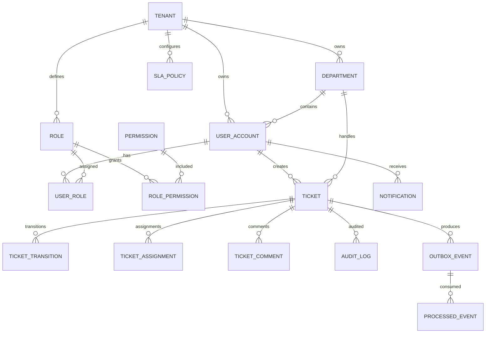

# FlowOps MVP 数据库设计

## 1. 设计范围

本设计对应 `01-mvp-architecture.md` 的第一版业务范围，数据库使用 MySQL 8、InnoDB 和 `utf8mb4`。

第一版共设计 17 张表，按开发顺序分为三组：

| 阶段 | 目标 | 表 |
| --- | --- | --- |
| 第一阶段 | 登录、租户、RBAC、创建与查询工单 | `tenant`、`department`、`user_account`、`role`、`permission`、`user_role`、`role_permission`、`sla_policy`、`ticket`、`ticket_transition` |
| 第二阶段 | 分派、评论、审计和编号生成 | `ticket_assignment`、`ticket_comment`、`audit_log`、`ticket_number_sequence` |
| 第三阶段 | 可靠消息、幂等消费和站内通知 | `outbox_event`、`processed_event`、`notification` |

不要一次在 Navicat 中手工创建全部表。建议先完成第一阶段，并将最终 SQL 保存为 Flyway 迁移脚本；Navicat主要用于查看表、执行 SQL 和检查数据。

## 2. 全局字段规范

### 基础约定

- 主键统一使用 `BIGINT UNSIGNED`，Java 对应 `Long`。
- 时间统一使用 `DATETIME(3)`，数据库保存 UTC 时间，展示时转换到用户时区。
- 状态、类型、动作统一使用 `VARCHAR` 保存代码值，不使用 MySQL `ENUM`。
- 布尔值使用 `TINYINT UNSIGNED`，取值为 `0/1`。
- 金额以外不要使用 `DECIMAL`；分钟数使用 `INT UNSIGNED`。
- 所有表使用 `ENGINE=InnoDB`、`DEFAULT CHARSET=utf8mb4`、`COLLATE=utf8mb4_0900_ai_ci`。
- 除 `tenant`、`permission` 等平台级表外，业务表必须包含 `tenant_id`。
- 租户内唯一的数据，唯一索引必须以 `tenant_id` 开头。
- 不从客户端请求中获取可信 `tenant_id`，必须从登录上下文中取得。

### 通用审计字段

可更新的业务表通常包含：

| 字段 | 类型 | 必填 | 说明 |
| --- | --- | --- | --- |
| `created_at` | `DATETIME(3)` | 是 | 创建时间 |
| `created_by` | `BIGINT UNSIGNED` | 否 | 创建人；系统初始化数据可为空 |
| `updated_at` | `DATETIME(3)` | 是 | 最后更新时间 |
| `updated_by` | `BIGINT UNSIGNED` | 否 | 最后修改人 |
| `version` | `INT UNSIGNED` | 是 | 乐观锁版本，默认 `0` |

流水记录表（状态历史、审计、事件）只追加不修改，通常只保留 `created_at` 或 `occurred_at`，不需要 `updated_at` 与 `version`。

## 3. 租户与权限模块

### 3.1 `tenant`：企业租户

| 字段 | 类型 | 约束 | 说明 |
| --- | --- | --- | --- |
| `id` | `BIGINT UNSIGNED` | PK | 租户 ID |
| `tenant_code` | `VARCHAR(32)` | NOT NULL, UK | 租户代码，如 `ACME` |
| `tenant_name` | `VARCHAR(100)` | NOT NULL | 企业名称 |
| `status` | `VARCHAR(20)` | NOT NULL | `ACTIVE`、`DISABLED` |
| `contact_name` | `VARCHAR(50)` | NULL | 联系人 |
| `contact_email` | `VARCHAR(128)` | NULL | 联系邮箱 |
| `contact_phone` | `VARCHAR(32)` | NULL | 联系电话 |
| `created_at` | `DATETIME(3)` | NOT NULL | 创建时间 |
| `created_by` | `BIGINT UNSIGNED` | NULL | 平台操作人 |
| `updated_at` | `DATETIME(3)` | NOT NULL | 更新时间 |
| `updated_by` | `BIGINT UNSIGNED` | NULL | 平台操作人 |
| `version` | `INT UNSIGNED` | NOT NULL | 乐观锁版本 |

索引：

- `uk_tenant_code (tenant_code)`
- `idx_tenant_status (status)`

### 3.2 `department`：部门

| 字段 | 类型 | 约束 | 说明 |
| --- | --- | --- | --- |
| `id` | `BIGINT UNSIGNED` | PK | 部门 ID |
| `tenant_id` | `BIGINT UNSIGNED` | NOT NULL | 所属租户 |
| `parent_id` | `BIGINT UNSIGNED` | NULL | 上级部门；根部门为空 |
| `department_code` | `VARCHAR(32)` | NOT NULL | 租户内部门代码 |
| `department_name` | `VARCHAR(100)` | NOT NULL | 部门名称 |
| `leader_user_id` | `BIGINT UNSIGNED` | NULL | 部门负责人 |
| `sort_order` | `INT` | NOT NULL | 展示顺序，默认 `0` |
| `status` | `VARCHAR(20)` | NOT NULL | `ACTIVE`、`DISABLED` |
| `created_at` | `DATETIME(3)` | NOT NULL | 创建时间 |
| `created_by` | `BIGINT UNSIGNED` | NULL | 创建人 |
| `updated_at` | `DATETIME(3)` | NOT NULL | 更新时间 |
| `updated_by` | `BIGINT UNSIGNED` | NULL | 修改人 |
| `version` | `INT UNSIGNED` | NOT NULL | 乐观锁版本 |

索引：

- `uk_department_code (tenant_id, department_code)`
- `idx_department_parent (tenant_id, parent_id, sort_order)`
- `idx_department_leader (tenant_id, leader_user_id)`

第一版只支持树形部门，不使用闭包表。查询完整组织树时可一次查出租户全部部门，再在 Java 内组装。

### 3.3 `user_account`：企业用户账号

| 字段 | 类型 | 约束 | 说明 |
| --- | --- | --- | --- |
| `id` | `BIGINT UNSIGNED` | PK | 用户 ID |
| `tenant_id` | `BIGINT UNSIGNED` | NOT NULL | 所属租户 |
| `department_id` | `BIGINT UNSIGNED` | NOT NULL | 当前主部门 |
| `username` | `VARCHAR(64)` | NOT NULL | 登录名 |
| `password_hash` | `VARCHAR(255)` | NOT NULL | BCrypt 等算法生成的密码摘要 |
| `display_name` | `VARCHAR(64)` | NOT NULL | 用户显示名称 |
| `email` | `VARCHAR(128)` | NULL | 邮箱 |
| `phone` | `VARCHAR(32)` | NULL | 手机号 |
| `status` | `VARCHAR(20)` | NOT NULL | `ACTIVE`、`LOCKED`、`DISABLED` |
| `last_login_at` | `DATETIME(3)` | NULL | 最近登录时间 |
| `password_changed_at` | `DATETIME(3)` | NULL | 最近修改密码时间 |
| `created_at` | `DATETIME(3)` | NOT NULL | 创建时间 |
| `created_by` | `BIGINT UNSIGNED` | NULL | 创建人 |
| `updated_at` | `DATETIME(3)` | NOT NULL | 更新时间 |
| `updated_by` | `BIGINT UNSIGNED` | NULL | 修改人 |
| `version` | `INT UNSIGNED` | NOT NULL | 乐观锁版本 |

索引：

- `uk_user_username (tenant_id, username)`
- `idx_user_department (tenant_id, department_id, status)`
- `idx_user_email (tenant_id, email)`

第一版不允许删除已经参与工单的用户，只允许将账号改为 `DISABLED`，从而保留历史记录。

### 3.4 `role`：租户角色

| 字段 | 类型 | 约束 | 说明 |
| --- | --- | --- | --- |
| `id` | `BIGINT UNSIGNED` | PK | 角色 ID |
| `tenant_id` | `BIGINT UNSIGNED` | NOT NULL | 所属租户 |
| `role_code` | `VARCHAR(64)` | NOT NULL | 如 `TENANT_ADMIN`、`AGENT` |
| `role_name` | `VARCHAR(64)` | NOT NULL | 角色名称 |
| `description` | `VARCHAR(255)` | NULL | 角色说明 |
| `built_in` | `TINYINT UNSIGNED` | NOT NULL | 是否内置角色，默认 `0` |
| `status` | `VARCHAR(20)` | NOT NULL | `ACTIVE`、`DISABLED` |
| `created_at` | `DATETIME(3)` | NOT NULL | 创建时间 |
| `created_by` | `BIGINT UNSIGNED` | NULL | 创建人 |
| `updated_at` | `DATETIME(3)` | NOT NULL | 更新时间 |
| `updated_by` | `BIGINT UNSIGNED` | NULL | 修改人 |
| `version` | `INT UNSIGNED` | NOT NULL | 乐观锁版本 |

索引：

- `uk_role_code (tenant_id, role_code)`
- `idx_role_status (tenant_id, status)`

### 3.5 `permission`：平台权限定义

| 字段 | 类型 | 约束 | 说明 |
| --- | --- | --- | --- |
| `id` | `BIGINT UNSIGNED` | PK | 权限 ID |
| `permission_code` | `VARCHAR(100)` | NOT NULL, UK | 如 `ticket:assign` |
| `permission_name` | `VARCHAR(100)` | NOT NULL | 中文名称 |
| `resource` | `VARCHAR(50)` | NOT NULL | 如 `ticket` |
| `action` | `VARCHAR(50)` | NOT NULL | 如 `assign` |
| `scope` | `VARCHAR(30)` | NULL | `OWN`、`DEPARTMENT`、`TENANT` |
| `description` | `VARCHAR(255)` | NULL | 权限说明 |
| `status` | `VARCHAR(20)` | NOT NULL | `ACTIVE`、`DISABLED` |
| `created_at` | `DATETIME(3)` | NOT NULL | 创建时间 |
| `updated_at` | `DATETIME(3)` | NOT NULL | 更新时间 |

索引：

- `uk_permission_code (permission_code)`
- `idx_permission_resource (resource, action)`

权限是平台维护的代码字典，不允许每个租户随意创建，因此不包含 `tenant_id`。

### 3.6 `user_role`：用户与角色关系

| 字段 | 类型 | 约束 | 说明 |
| --- | --- | --- | --- |
| `id` | `BIGINT UNSIGNED` | PK | 关系 ID |
| `tenant_id` | `BIGINT UNSIGNED` | NOT NULL | 所属租户 |
| `user_id` | `BIGINT UNSIGNED` | NOT NULL | 用户 ID |
| `role_id` | `BIGINT UNSIGNED` | NOT NULL | 角色 ID |
| `assigned_by` | `BIGINT UNSIGNED` | NULL | 授权操作人 |
| `assigned_at` | `DATETIME(3)` | NOT NULL | 授权时间 |

索引：

- `uk_user_role (tenant_id, user_id, role_id)`
- `idx_user_role_role (tenant_id, role_id, user_id)`

使用独立 `id` 而非复合主键，便于 MyBatis-Plus 实体映射；业务唯一性由组合唯一索引保证。

### 3.7 `role_permission`：角色与权限关系

| 字段 | 类型 | 约束 | 说明 |
| --- | --- | --- | --- |
| `id` | `BIGINT UNSIGNED` | PK | 关系 ID |
| `tenant_id` | `BIGINT UNSIGNED` | NOT NULL | 角色所属租户 |
| `role_id` | `BIGINT UNSIGNED` | NOT NULL | 角色 ID |
| `permission_id` | `BIGINT UNSIGNED` | NOT NULL | 权限 ID |
| `granted_by` | `BIGINT UNSIGNED` | NULL | 授权操作人 |
| `granted_at` | `DATETIME(3)` | NOT NULL | 授权时间 |

索引：

- `uk_role_permission (tenant_id, role_id, permission_id)`
- `idx_role_permission_permission (permission_id, role_id)`

## 4. 工单模块

### 4.1 `sla_policy`：租户 SLA 策略

| 字段 | 类型 | 约束 | 说明 |
| --- | --- | --- | --- |
| `id` | `BIGINT UNSIGNED` | PK | 策略 ID |
| `tenant_id` | `BIGINT UNSIGNED` | NOT NULL | 所属租户 |
| `policy_name` | `VARCHAR(100)` | NOT NULL | 如“默认 P0 策略” |
| `priority` | `VARCHAR(10)` | NOT NULL | `P0`、`P1`、`P2` |
| `response_minutes` | `INT UNSIGNED` | NOT NULL | 响应时限分钟数 |
| `resolution_minutes` | `INT UNSIGNED` | NOT NULL | 解决时限分钟数 |
| `enabled` | `TINYINT UNSIGNED` | NOT NULL | 是否启用 |
| `created_at` | `DATETIME(3)` | NOT NULL | 创建时间 |
| `created_by` | `BIGINT UNSIGNED` | NULL | 创建人 |
| `updated_at` | `DATETIME(3)` | NOT NULL | 更新时间 |
| `updated_by` | `BIGINT UNSIGNED` | NULL | 修改人 |
| `version` | `INT UNSIGNED` | NOT NULL | 乐观锁版本 |

索引：

- `uk_sla_priority (tenant_id, priority)`
- `idx_sla_enabled (tenant_id, enabled)`

第一版每个租户、每个优先级只有一个策略。工单创建时将时限计算为截止时间写入 `ticket`，策略修改不追溯历史工单。

### 4.2 `ticket`：工单主表

| 字段 | 类型 | 约束 | 说明 |
| --- | --- | --- | --- |
| `id` | `BIGINT UNSIGNED` | PK | 工单 ID |
| `tenant_id` | `BIGINT UNSIGNED` | NOT NULL | 所属租户 |
| `ticket_no` | `VARCHAR(40)` | NOT NULL | 租户内展示编号 |
| `title` | `VARCHAR(200)` | NOT NULL | 工单标题 |
| `description` | `TEXT` | NOT NULL | 问题描述 |
| `ticket_type` | `VARCHAR(30)` | NOT NULL | `INCIDENT`、`ACCESS_REQUEST`、`REPAIR`、`CUSTOMER_ISSUE`、`BUG`、`APPROVAL` |
| `priority` | `VARCHAR(10)` | NOT NULL | `P0`、`P1`、`P2` |
| `status` | `VARCHAR(30)` | NOT NULL | 当前状态 |
| `creator_id` | `BIGINT UNSIGNED` | NOT NULL | 创建人 |
| `creator_department_id` | `BIGINT UNSIGNED` | NOT NULL | 创建时所属部门快照 |
| `handling_department_id` | `BIGINT UNSIGNED` | NOT NULL | 当前负责部门 |
| `current_assignee_id` | `BIGINT UNSIGNED` | NULL | 当前处理人 |
| `first_response_at` | `DATETIME(3)` | NULL | 首次接单/响应时间 |
| `resolution_submitted_at` | `DATETIME(3)` | NULL | 提交解决方案时间 |
| `resolved_at` | `DATETIME(3)` | NULL | 创建人确认解决时间 |
| `closed_at` | `DATETIME(3)` | NULL | 关闭时间 |
| `response_due_at` | `DATETIME(3)` | NOT NULL | 响应截止时间快照 |
| `resolution_due_at` | `DATETIME(3)` | NOT NULL | 解决截止时间快照 |
| `response_sla_status` | `VARCHAR(20)` | NOT NULL | `PENDING`、`MET`、`BREACHED` |
| `resolution_sla_status` | `VARCHAR(20)` | NOT NULL | `PENDING`、`MET`、`BREACHED` |
| `response_breached_at` | `DATETIME(3)` | NULL | 响应 SLA 首次超时时间 |
| `resolution_breached_at` | `DATETIME(3)` | NULL | 解决 SLA 首次超时时间 |
| `resolution` | `TEXT` | NULL | 当前提交的解决方案 |
| `created_at` | `DATETIME(3)` | NOT NULL | 创建时间 |
| `updated_at` | `DATETIME(3)` | NOT NULL | 更新时间 |
| `updated_by` | `BIGINT UNSIGNED` | NULL | 最近操作人 |
| `version` | `INT UNSIGNED` | NOT NULL | 乐观锁版本 |

索引：

- `uk_ticket_no (tenant_id, ticket_no)`
- `idx_ticket_status (tenant_id, status, updated_at)`
- `idx_ticket_creator (tenant_id, creator_id, created_at)`
- `idx_ticket_assignee (tenant_id, current_assignee_id, status, updated_at)`
- `idx_ticket_department (tenant_id, handling_department_id, status, updated_at)`
- `idx_ticket_response_sla (tenant_id, response_sla_status, response_due_at)`
- `idx_ticket_resolution_sla (tenant_id, resolution_sla_status, resolution_due_at)`

`creator_department_id` 与 `handling_department_id` 必须分开：前者记录谁提出问题，后者决定谁负责处理。用户之后转部门也不能改变历史工单的创建部门。

### 4.3 `ticket_transition`：工单状态流转历史

| 字段 | 类型 | 约束 | 说明 |
| --- | --- | --- | --- |
| `id` | `BIGINT UNSIGNED` | PK | 流转记录 ID |
| `tenant_id` | `BIGINT UNSIGNED` | NOT NULL | 所属租户 |
| `ticket_id` | `BIGINT UNSIGNED` | NOT NULL | 工单 ID |
| `action` | `VARCHAR(30)` | NOT NULL | `ASSIGN`、`ACCEPT`、`START_PROCESS`、`SUBMIT_RESOLUTION`、`CONFIRM`、`REJECT`、`CLOSE` |
| `from_status` | `VARCHAR(30)` | NOT NULL | 原状态 |
| `to_status` | `VARCHAR(30)` | NOT NULL | 新状态 |
| `operator_id` | `BIGINT UNSIGNED` | NOT NULL | 操作人 |
| `remark` | `VARCHAR(500)` | NULL | 本次操作说明 |
| `ticket_version` | `INT UNSIGNED` | NOT NULL | 流转后的工单版本 |
| `created_at` | `DATETIME(3)` | NOT NULL | 流转时间 |

索引：

- `idx_transition_ticket (tenant_id, ticket_id, created_at)`
- `idx_transition_operator (tenant_id, operator_id, created_at)`

状态流转记录是业务历史，不允许修改和删除。

### 4.4 `ticket_assignment`：工单分派历史

| 字段 | 类型 | 约束 | 说明 |
| --- | --- | --- | --- |
| `id` | `BIGINT UNSIGNED` | PK | 分派记录 ID |
| `tenant_id` | `BIGINT UNSIGNED` | NOT NULL | 所属租户 |
| `ticket_id` | `BIGINT UNSIGNED` | NOT NULL | 工单 ID |
| `assignment_type` | `VARCHAR(20)` | NOT NULL | `ASSIGN`、`REASSIGN`、`UNASSIGN` |
| `from_department_id` | `BIGINT UNSIGNED` | NULL | 原负责部门 |
| `to_department_id` | `BIGINT UNSIGNED` | NOT NULL | 新负责部门 |
| `from_assignee_id` | `BIGINT UNSIGNED` | NULL | 原处理人 |
| `to_assignee_id` | `BIGINT UNSIGNED` | NULL | 新处理人 |
| `assigned_by` | `BIGINT UNSIGNED` | NOT NULL | 分派操作人 |
| `reason` | `VARCHAR(500)` | NULL | 分派或改派原因 |
| `ticket_version` | `INT UNSIGNED` | NOT NULL | 分派后的工单版本 |
| `created_at` | `DATETIME(3)` | NOT NULL | 分派时间 |

索引：

- `idx_assignment_ticket (tenant_id, ticket_id, created_at)`
- `idx_assignment_assignee (tenant_id, to_assignee_id, created_at)`

`ticket.current_assignee_id` 保存当前值，方便查询；本表保存历史。两者属于“当前快照 + 历史流水”，不是无意义重复。

### 4.5 `ticket_comment`：工单评论

| 字段 | 类型 | 约束 | 说明 |
| --- | --- | --- | --- |
| `id` | `BIGINT UNSIGNED` | PK | 评论 ID |
| `tenant_id` | `BIGINT UNSIGNED` | NOT NULL | 所属租户 |
| `ticket_id` | `BIGINT UNSIGNED` | NOT NULL | 工单 ID |
| `author_id` | `BIGINT UNSIGNED` | NOT NULL | 评论人 |
| `content` | `TEXT` | NOT NULL | 评论内容 |
| `visibility` | `VARCHAR(20)` | NOT NULL | `PUBLIC`、`INTERNAL` |
| `created_at` | `DATETIME(3)` | NOT NULL | 评论时间 |

索引：

- `idx_comment_ticket (tenant_id, ticket_id, created_at)`
- `idx_comment_author (tenant_id, author_id, created_at)`

第一版评论不可编辑和删除，避免审计歧义。若写错，可追加一条更正说明。

### 4.6 `ticket_number_sequence`：租户每日工单编号序列

| 字段 | 类型 | 约束 | 说明 |
| --- | --- | --- | --- |
| `id` | `BIGINT UNSIGNED` | PK | 序列记录 ID |
| `tenant_id` | `BIGINT UNSIGNED` | NOT NULL | 所属租户 |
| `sequence_date` | `DATE` | NOT NULL | 编号日期 |
| `current_value` | `INT UNSIGNED` | NOT NULL | 当日已使用最大序号 |
| `updated_at` | `DATETIME(3)` | NOT NULL | 更新时间 |
| `version` | `INT UNSIGNED` | NOT NULL | 并发更新版本 |

索引：

- `uk_ticket_sequence (tenant_id, sequence_date)`

用于生成类似 `OPS-20260716-0001` 的编号。必须通过原子更新或事务加锁取得下一个值，不能先查再普通更新。

## 5. 审计与消息模块

### 5.1 `audit_log`：操作审计日志

| 字段 | 类型 | 约束 | 说明 |
| --- | --- | --- | --- |
| `id` | `BIGINT UNSIGNED` | PK | 审计记录 ID |
| `tenant_id` | `BIGINT UNSIGNED` | NOT NULL | 所属租户 |
| `module` | `VARCHAR(30)` | NOT NULL | 如 `TICKET`、`USER`、`ROLE` |
| `operation` | `VARCHAR(50)` | NOT NULL | 如 `TICKET_ASSIGN` |
| `resource_type` | `VARCHAR(50)` | NOT NULL | 资源类型 |
| `resource_id` | `BIGINT UNSIGNED` | NULL | 资源 ID |
| `operator_id` | `BIGINT UNSIGNED` | NULL | 操作人；系统任务可为空 |
| `trace_id` | `VARCHAR(64)` | NULL | 链路追踪 ID |
| `request_ip` | `VARCHAR(45)` | NULL | IPv4 或 IPv6 |
| `result` | `VARCHAR(20)` | NOT NULL | `SUCCESS`、`FAILURE` |
| `before_data` | `JSON` | NULL | 操作前关键数据 |
| `after_data` | `JSON` | NULL | 操作后关键数据 |
| `error_message` | `VARCHAR(500)` | NULL | 失败摘要，不保存堆栈 |
| `occurred_at` | `DATETIME(3)` | NOT NULL | 发生时间 |

索引：

- `idx_audit_resource (tenant_id, resource_type, resource_id, occurred_at)`
- `idx_audit_operator (tenant_id, operator_id, occurred_at)`
- `idx_audit_trace (trace_id)`

审计数据中不得保存密码、JWT、完整敏感正文等信息。

### 5.2 `outbox_event`：待发布领域事件

| 字段 | 类型 | 约束 | 说明 |
| --- | --- | --- | --- |
| `id` | `BIGINT UNSIGNED` | PK | 数据库记录 ID |
| `event_id` | `CHAR(36)` | NOT NULL, UK | 对外事件 UUID |
| `tenant_id` | `BIGINT UNSIGNED` | NOT NULL | 所属租户 |
| `aggregate_type` | `VARCHAR(50)` | NOT NULL | 如 `TICKET` |
| `aggregate_id` | `BIGINT UNSIGNED` | NOT NULL | 聚合根 ID |
| `event_type` | `VARCHAR(100)` | NOT NULL | 如 `TICKET_CREATED` |
| `payload` | `JSON` | NOT NULL | 事件负载 |
| `status` | `VARCHAR(20)` | NOT NULL | `PENDING`、`PUBLISHED`、`FAILED` |
| `retry_count` | `INT UNSIGNED` | NOT NULL | 已重试次数 |
| `next_retry_at` | `DATETIME(3)` | NULL | 下次重试时间 |
| `published_at` | `DATETIME(3)` | NULL | 成功发布时间 |
| `last_error` | `VARCHAR(500)` | NULL | 最近失败摘要 |
| `created_at` | `DATETIME(3)` | NOT NULL | 创建时间 |

索引：

- `uk_outbox_event_id (event_id)`
- `idx_outbox_publish (status, next_retry_at, created_at)`
- `idx_outbox_aggregate (tenant_id, aggregate_type, aggregate_id)`

业务数据和 Outbox 事件必须在同一个数据库事务中写入。

### 5.3 `processed_event`：消费者幂等记录

| 字段 | 类型 | 约束 | 说明 |
| --- | --- | --- | --- |
| `id` | `BIGINT UNSIGNED` | PK | 记录 ID |
| `tenant_id` | `BIGINT UNSIGNED` | NOT NULL | 所属租户 |
| `event_id` | `CHAR(36)` | NOT NULL | 事件 ID |
| `consumer_name` | `VARCHAR(100)` | NOT NULL | 消费者名称 |
| `processed_at` | `DATETIME(3)` | NOT NULL | 成功处理时间 |

索引：

- `uk_processed_event (consumer_name, event_id)`
- `idx_processed_tenant (tenant_id, processed_at)`

同一事件可以被不同消费者各处理一次，因此唯一键是 `consumer_name + event_id`，不是只对 `event_id` 唯一。

### 5.4 `notification`：站内通知

| 字段 | 类型 | 约束 | 说明 |
| --- | --- | --- | --- |
| `id` | `BIGINT UNSIGNED` | PK | 通知 ID |
| `tenant_id` | `BIGINT UNSIGNED` | NOT NULL | 所属租户 |
| `recipient_id` | `BIGINT UNSIGNED` | NOT NULL | 接收用户 |
| `notification_type` | `VARCHAR(50)` | NOT NULL | `TICKET_ASSIGNED`、`SLA_BREACHED` 等 |
| `title` | `VARCHAR(200)` | NOT NULL | 通知标题 |
| `content` | `VARCHAR(1000)` | NOT NULL | 通知内容 |
| `business_type` | `VARCHAR(50)` | NOT NULL | 如 `TICKET` |
| `business_id` | `BIGINT UNSIGNED` | NOT NULL | 关联业务 ID |
| `source_event_id` | `CHAR(36)` | NULL | 来源事件，用于幂等 |
| `read_at` | `DATETIME(3)` | NULL | 为空表示未读 |
| `created_at` | `DATETIME(3)` | NOT NULL | 创建时间 |

索引：

- `idx_notification_inbox (tenant_id, recipient_id, read_at, created_at)`
- `uk_notification_event (tenant_id, recipient_id, source_event_id, notification_type)`

第一版只实现站内通知，不提前设计邮件、短信和企业微信发送记录。新增外部渠道后，再独立设计 `notification_delivery`。

## 6. 表关系

## 7. 关键选择与取舍

### 7.1 状态字段：`VARCHAR` 还是 MySQL `ENUM`

| 项目 | 内容 |
| --- | --- |
| 备选方案 | MySQL `ENUM`；`TINYINT` 数字码；`VARCHAR` 字符串码 |
| 推荐 | `VARCHAR` 字符串码 |
| 为什么选它 | Navicat 中可直接读懂，Java 枚举映射清晰，新增状态时不需要修改字段定义 |
| 为什么不选其他方案 | `ENUM` 会把领域变化绑定到数据库 DDL；数字码可读性差，排查数据时容易误解 |
| 何时重评 | 单表达到超大规模且状态字段索引空间成为真实瓶颈时 |

### 7.2 外键：物理外键还是逻辑外键

| 项目 | 内容 |
| --- | --- |
| 备选方案 | MySQL 物理外键；应用层逻辑外键 |
| 推荐 | MVP 使用逻辑外键，同时建立必要索引和唯一约束 |
| 为什么选它 | 模块化单体迁移、测试数据准备、批量处理更加简单，也能避免循环引用导致建表顺序复杂 |
| 为什么不选其他方案 | 物理外键能加强数据完整性，但会增加迁移、删除策略和跨模块演进成本；大量级联删除尤其危险 |
| 何时重评 | 数据质量问题频繁出现，或团队无法稳定保证引用完整性时，可为核心关系增加包含 `tenant_id` 的组合外键 |

### 7.3 用户和部门：一对多还是多对多

| 项目 | 内容 |
| --- | --- |
| 备选方案 | 用户一个主部门；增加 `user_department` 支持多部门 |
| 推荐 | 第一版一个用户属于一个主部门 |
| 为什么选它 | 当前数据权限和部门负责人规则更容易解释、查询和测试 |
| 为什么不选其他方案 | 多部门会立刻引入主部门、兼职部门、跨部门数据权限合并等规则，MVP 尚无真实需求 |
| 何时重评 | 出现兼职处理人、矩阵组织或一个用户必须管理多个部门时 |

### 7.4 工单类型：代码枚举还是配置表

| 项目 | 内容 |
| --- | --- |
| 备选方案 | Java 枚举/字符串码；`ticket_type` 配置表；完整工作流定义表 |
| 推荐 | 第一版使用代码枚举并保存字符串码 |
| 为什么选它 | 当前工单流程固定，能先把状态、安全和并发做扎实 |
| 为什么不选其他方案 | 类型配置表还需要表单、流程、处理部门和权限规则；工作流表会显著扩大第一版范围 |
| 何时重评 | 企业管理员明确需要自行新增类型，且不同类型确实存在不同字段或状态流程时 |

### 7.5 删除策略：软删除还是禁用

| 项目 | 内容 |
| --- | --- |
| 备选方案 | `deleted` 软删除；物理删除；状态禁用 |
| 推荐 | 用户、部门、角色使用状态禁用；工单和流水不删除 |
| 为什么选它 | 历史工单仍需要显示原用户和部门，禁用语义比“假装删除”更符合企业系统 |
| 为什么不选其他方案 | 软删除会影响所有唯一索引和查询条件；物理删除会破坏审计与历史引用 |
| 何时重评 | 出现数据保护法规要求的匿名化/删除流程时，设计专门的数据脱敏与归档机制 |

## 8. Navicat 建表顺序

建议按依赖关系执行：

1. `tenant`
2. `department`
3. `user_account`
4. `permission`
5. `role`
6. `user_role`
7. `role_permission`
8. `sla_policy`
9. `ticket_number_sequence`
10. `ticket`
11. `ticket_transition`
12. `ticket_assignment`
13. `ticket_comment`
14. `audit_log`
15. `outbox_event`
16. `processed_event`
17. `notification`

第一轮只创建第 1～10 张表即可。完成登录、权限以及工单创建/查询后，再继续创建历史和消息相关表。

## 9. 第一轮验收标准

- 两个租户可以拥有相同的 `username`、`department_code` 和 `role_code`。
- 同一租户不允许出现重复 `username`、`ticket_no` 和同优先级 SLA。
- 已禁用用户不能登录，但历史工单仍能根据用户 ID 找到其显示名称。
- 工单能区分创建人部门和处理部门。
- 并发修改同一工单时，只有版本匹配的更新能成功。
- 查询用户工单、部门工单和处理人工单时，索引都以 `tenant_id` 开头。
- 修改 SLA 策略后，已经创建的工单截止时间保持不变。
